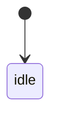
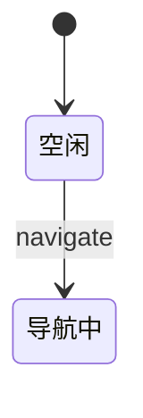

# Markdown 到 DOCX 格式约束

本规范是本项目 Markdown 到 DOCX 转换的输入和验收契约。适用对象为项目交付、评审和验收文档。Markdown 是唯一源文件，DOCX 是生成产物；发现格式问题时，优先修改源 Markdown、过滤器、后处理脚本或模板，不直接修改生成的 DOCX。

文中术语含义：

- **必须**：不满足时不得进入正式转换或验收；
- **建议**：用于改善可读性和跨版本稳定性；
- **实现说明**：描述当前项目转换器行为，不等同于通用 Markdown 或 Pandoc 语法。

## 1. 输入结构与标题

### 1.1 根标题和正文层级

本项目输入必须以且仅以一个一级标题开头。第一个 `#` 用作封面标题，正文从 `##` 开始：

```markdown
# 文档名称

## 1 服务概述

### 1.1 功能说明
```

当前转换映射如下：

**标题层级映射**

| Markdown | DOCX 样式 | 用途 |
|---|---|---|
| 第一个 `#` | `Title` | 封面标题，不作为正文章节 |
| 后续 `##` | `Heading1` | 正文一级章节 |
| 后续 `###` | `Heading2` | 正文二级章节 |
| 后续 `####` | `Heading3` | 正文三级章节 |
| 后续 `#####` | `Heading4` | 正文四级章节 |

规则：

- 正文标题不得跳级；这是项目可读性和题注编号的输入要求，不是转换器的报错机制；
- 不要把正文一级章节写成多个并列的 `#`；
- 代码块、引用和行内代码中的 `#` 不属于标题；
- 第一个 `#` 后可以紧跟封面信息表，不要再插入并列的 `#` 作为正文标题；
- `---` 在当前转换中会被丢弃，不用于控制 DOCX 分页。

### 1.2 标题编号

标题编号优先由 `reference.docx` 的多级标题样式自动生成。若源标题保留手写编号，当前 `layout.lua` 只可靠处理标题开头的数字点号编号，且编号后必须有一个空格，例如：

```markdown
## 1 服务概述
### 1.1 功能说明
```

不要使用或混用以下未由当前过滤器可靠剥离的形式：`第一章`、`一、`、`（一）`、`1、`、罗马数字等。不要同时依赖复杂手写编号和 Word 自动编号。

### 1.3 附录

附录必须位于正文末尾，标题文本以“附录”开头。附录的具体层级和样式依赖当前 `layout.lua` 与模板实现；修改附录结构时，应先用实际转换验证，不要仅依据通用 Markdown 习惯推断 DOCX 样式。

### 1.4 标题措辞与括号

标题必须使用纯名词性短语；章节标题与接口名一律不使用括号补充，括号中的信息按类型写入标题下的正文：

- 加粗接口段落名（见 2.3）中唯一允许的括号是组内 `（a）（b）` 编号；增量、兼容、废弃、访问范围、存储行为等说明写入接口名下的说明行；
- 章节标题不使用括号。原括号信息按类型落地：标识符（代码文件名、数据结构）写入标题下的信息行，如“入口文件：`auth_server_v4.py`”；调用方向名词化并入标题主干，如“Storage 命令下发接口”，或写入正文；清单计数写入节引言，如“全部接口共 19 个，分为 6 组”；
- 正文、表格与代码块中的括号与符号按其原始语义保留，不受标题规则限制。

## 2. 封面、正文和接口写法

### 2.1 封面信息表

封面信息表必须紧跟第一个 `#` 标题，才会被转换器识别为封面表：

```markdown
# 文档名称

| 项目 | 内容 |
|---|---|
| 版本 | v1.0 |

## 1 服务概述
```

封面表与普通正文表不同：转换器会对其进行特殊排版，可能移除表头并加粗首列；它不作为普通表格题注处理。

### 2.2 正式文风

标题和正文必须使用正式、客观、可核验的技术表达：

- 标题使用准确、平行的名词性表述，描述对象、功能、流程、配置、异常或验收内容；
- 使用陈述句、定义句和规范性语句，明确条件、动作、结果和约束；
- 禁止使用聊天式标题、网络用语、模糊表达、感叹号和装饰性符号；
- 禁止在标题或规范正文中使用 `→`、`⇒`、`➜` 代替正式连接词；使用“进入”“转换为”“调用”“触发”“返回”“随后”等文字；
- 验收结论应写明对象、前置条件、操作、预期结果和判定标准，不单独使用“正常”“通过”“可用”等结论。
- 口语化表述的批量排查与对照词表使用 `tools/md_style_audit.py`（`--list` 查看词表；缺省只读扫描，`--apply` 仅执行无歧义词级替换）。

代码块、代码标识和原文引用中的符号按其原始语义保留，不按正文禁用规则处理。

### 2.3 接口小标题

完整 URL、方法和查询参数不得作为 Markdown 标题。接口分类使用标题，具体接口使用加粗段落：

```markdown
### 任务管理

**（a）分页查询任务**

接口：`GET /service/instrument/autoInspection/getPagingAutoInspection`
```

- 接口分类使用 `###` 或 `####`；
- 单个接口名称使用加粗段落，不使用标题；
- 方法和路径另起一行，使用行内代码；
- 同一接口组使用连续的中文括号字母编号；
- 接口名称本身不使用括号补充限定，行为说明写在名称下的说明行（`（a）（b）` 组内编号除外，详见 1.4）；
- 表格内可以保留完整路径。

### 2.4 提示和特殊字符

面向 DOCX 的正文不使用提示类 Emoji，例如 `⚠️`、`✅`、`❌`、`❗`。使用普通文字、加粗文字或引用块：

```markdown
> **注意**：终止后不可恢复，需重新导航或执行新任务。
```

代码块和必要的原文引用不在此限制范围内。

## 3. 表格、图片与题注

表格、图片和 Mermaid 图必须有明确的语义题目，不能只留下空白题注或仅依赖自动序号。语义题目说明内容对象，题号由转换器自动生成；源 Markdown 不得手写“表 1-1”“图 2-3”等编号。

### 3.1 表格题目

普通表格使用标准 Markdown 管线语法，并在表格前写一行加粗表题：

```markdown
**导航状态字段表**

| 字段 | 类型 | 说明 |
|---|---|---|
| state | string | 当前导航状态 |
```

规则：

- 普通表格前必须有简洁、准确的语义表题；
- 表题不得使用手写序号，`layout.lua`、Word 域和配套 `reference.docx` 自动生成“表 N-M”题注；
- 普通表格题注依赖正文 `##` 映射的 `Heading1`、正确章节计数和 `STYLEREF 1 \\s` 字段；
- 表格题目应与表内容一致，不使用“表格”“数据表”等无意义名称；
- 封面信息表是唯一例外：它必须紧跟封面标题，由转换器特殊排版，不作为普通表格题注处理；
- 附录表格同样必须有语义表题，题号由转换器使用独立的附表序列生成。

### 3.2 图片和 Mermaid 图题

独立图片必须提供图题；Mermaid 代码块必须在首行提供 `fig-cap`：

````markdown

````

- `fig-cap` 或图片标题必须准确说明图示对象和用途；
- 不得只写“示意图”“流程图”“图片”等无信息标题；
- 不得手写“图 N-M”编号，编号由 `layout.lua` 和 Word 域生成；
- 每个成功渲染的 Mermaid 图块或独立图片应生成一个带语义题目的 DOCX 图题。

出现题注样式错误、章节号为 0、题目缺失或序号异常时，依次检查：题目文本、正文 `Heading1`、`layout.lua` 的标题映射、题注字段、配套模板版本以及 Word 域是否需要更新。

## 4. 代码和结构化数据

JSON、Shell、Python、YAML 等结构化内容必须使用带语言标识的围栏代码块：

````markdown
```json
{
  "action": "send_navigate",
  "points_id": "P001"
}
```
````

- 使用三个反引号并标注语言；
- JSON 按项目风格使用 2 个空格缩进，字段尽量一行一个；
- 大段 JSON 或代码不得放在普通段落、列表项或表格单元格中；
- 嵌套 JSON 字符串可以保留转义，但应在代码块外说明其含义；
- 短代码使用单个反引号；
- 围栏代码块中的 `#` 不会被识别为标题。

实现说明：当前 `layout.lua` 会将行内代码还原为普通文本，表格内的行内代码也会被剥离为普通文本；只有独立围栏代码块按代码段处理。代码段的具体 DOCX 样式由 Pandoc 和 `reference.docx` 共同决定。

## 5. 数学公式

行内数学使用 `$...$`，独立公式使用 `$$...$$`，由 Pandoc 的数学解析器（texmath）转换为 Word 原生 OMML 公式。显示公式段落在后处理中自动改用「公式」样式（复用图格式的自动行距，避免正文固定行距覆盖公式）。

规则：

- 只使用 texmath 支持的 LaTeX 命令。禁止 `\rm`、`\bf`、`\it`、`\tt`、`\sc` 等已弃用的 TeX 字体切换原语：这类命令会使整条公式解析失败，公式连同 `$$` 定界符以源码字面量进入正文，不再是 OMML；
- 正体、粗体等字体效果使用带参数的等价命令 `\mathrm{...}`、`\mathbf{...}`、`\mathit{...}`、`\mathtt{...}`；上下标中的多字符说明整体放入参数，例如 `p_{\mathrm{no,b}}`、`e^{\mathrm{tx/rx}}`、`V_{{\mathrm{floor}},j}`；
- 多行公式使用 `aligned` 环境；公式编号沿用 `\tag{N}` 手写维护，与表格图题的自动编号无关；
- 单位、符号解释和“其中，……”体例写在公式外正文，不塞进公式；
- 转换以零数学警告为准：Pandoc 输出出现 `Could not convert TeX math` 或 `unexpected control sequence` 即表示有公式未转换为 OMML，必须先修改源公式再进入正式转换。可用 XML 定向检查 `m:oMath` 数量并搜索反斜杠命令字面量确认。

## 6. Mermaid 图示输入规范

Mermaid 是本项目图示输入政策。当前 `diagram.lua` 还支持其他图形引擎，但项目交付文档统一使用 Mermaid。流程图、状态机图、时序图、拓扑图和架构图必须使用 Mermaid 代码块；禁止使用 ASCII 拼接框图、`text` 图块或 `┌ ┐ └ ┘ │ ─` 等框线字符。

基本写法：

````markdown

````

- 代码块首行使用当前过滤器识别的 `%%| fig-cap: 图题` 格式；
- 图题由 `diagram.lua` 识别并交给 `layout.lua` 生成 DOCX 题注；
- 按语义选择 `flowchart`、`stateDiagram-v2` 或 `sequenceDiagram` 等图型；
- 节点和边标签只保留必要信息，完整说明放在图后正文、列表或表格；
- 简单布尔标记、赋值关系和少量条件优先使用正文或列表，不单独绘图；
- 不用一张图承载完整 JSON、长接口描述或过多业务说明。

## 7. Mermaid 布局、兼容性与输出

### 7.1 文本和布局建议

以下是排版建议，不是 Mermaid 语法硬性要求：

- 判断节点、处理节点和消息节点通常控制为 2 至 4 行；长条件使用 `<br/>` 主动换行；
- `pointsId`、`points_id`、`instruction` 等长标识按“对象、条件、结果”拆分，避免集中在一行；
- 长接口路径、JSON 和长句改用短标签，详细内容放到图外；
- 边标签避免过长文本、复杂括号、斜杠组合和多段业务说明；
- 判断框应保持横向宽度和纵向高度均衡，避免单个标签撑宽整图或形成狭长布局；
- 时序图参与者名称应简短，长说明不要放在 `Note` 中；
- 不为填满页面而放大内容较少的图，复杂内容应拆图或采用图文结合。

### 7.2 状态图和兼容性

- 状态图使用唯一状态 ID，并用 `id: 中文显示名` 指定显示文字；
- 不重复声明同一状态的 alias、中文名称和转移关系；
- 状态图尽量不使用 `note`，尤其不在其中放长段说明；
- 特殊字符使用 Mermaid 兼容写法，必要时使用引号包裹文本；
- 解析失败时，先用最简节点和短标签验证，再逐步恢复内容。

### 7.3 主题、viewport 和图片尺寸

转换器当前为 Mermaid 传入黑白配置：白色背景、白色节点、黑色边框、文字、连线和箭头。不使用黄色、彩色节点、彩色背景或渐变。

当前 `diagram.lua` 会根据 Mermaid 源码行数和最长行估算 viewport；这是实现细节，可能随脚本、Mermaid CLI 和模板版本变化。`width`、`height` 只是 `mmdc` 的渲染提示，最终 DOCX 尺寸以 Word XML 中的 `wp:extent` 为准。

图片进入 A4 正文区域后保持比例，当前后处理只在处理嵌入式图片并发现超限时缩小，不放大原本较小的图片：

- 最大宽度：`5,270,500 EMU`；
- 最大高度：`7,968,480 EMU`。

## 8. 工具链与维护边界

转换依赖：

- Pandoc `>= 3.0`；
- Mermaid CLI `mmdc`；
- Python 后处理依赖，例如 `lxml`。

建议使用可写的临时目录：

```bash
export PANDOC_DIAGRAM_TMP="$PWD/tools/pandoc-diagram-tmp"
```

若未设置，当前转换器使用相对当前转换工作目录的 `tools/pandoc-diagram-tmp`。临时目录必须可写；不要依赖只读系统目录或不可写的用户目录。

发现问题时按以下顺序处理：

1. 修改源 Markdown 的结构和内容；
2. 修改 `reference/layout.lua` 或 `reference/diagram.lua`；
3. 修改 `reference/postprocess.py`；
4. 最后调整配套 `reference.docx` 模板。

## 9. 生成与验收检查

### 9.1 转换前

- [ ] 输入以唯一封面一级标题开头，正文从 `##` 开始，标题不跳级；
- [ ] 标题（含章节标题与接口名）除组内 `（a）` 字母编号外一律不使用括号，括号信息已按 1.4 落入正文；
- [ ] 手写编号仅使用可由当前过滤器处理的数字点号加空格形式，或完全交由模板编号；
- [ ] 标题和正文使用正式、客观、可核验的表达，未使用正文流程箭头、提示 Emoji、网络用语或模糊表述；
- [ ] 封面信息表紧跟封面标题；普通表格没有手写题注编号；
- [ ] 接口长路径没有放入标题；代码块带语言标识，JSON 使用 2 个空格缩进；
- [ ] Mermaid 图块使用 `fig-cap`，没有 ASCII 框图，长标签已按语义换行；
- [ ] 数学公式未使用 `\rm`、`\bf` 等弃用 TeX 字体切换原语，正体等效果使用 `\mathrm{}` 等带参数命令；
- [ ] `mmdc`、Pandoc、Python 后处理依赖可用，临时目录可写。

### 9.2 转换后

- [ ] DOCX 能正常打开，没有 Word 修复提示；
- [ ] `Title`、`Heading1`、目录和自动编号正确；
- [ ] 普通表格题注、章节号和序号正确，封面信息表未误作为普通表格题注；
- [ ] 代码和 JSON 使用预期的代码段样式；
- [ ] 转换输出没有 `Could not convert TeX math` 警告，公式为 OMML（`m:oMath`），没有 TeX 源码字面量进入正文；
- [ ] 每个成功渲染的 Mermaid 图块有且仅有一个图题；图中没有空白框、文字重叠、解析错误或异常颜色；
- [ ] 图片 `wp:extent` 未超过宽高上限，且保持原始比例；
- [ ] 图片没有被无意义放大，正文和图示没有 ASCII 框线字符。

建议使用 XML 定向检查，而不是只依赖肉眼阅读全文：检查 `Heading1`、`TableCaption`、`STYLEREF` 字段、图题、图片 `wp:extent` 和错误提示文本。

### 9.3 常见故障

**常见故障与优先检查项**

| 现象 | 优先检查 |
|---|---|
| 表题样式错误、章节号为 0 | 正文 `Heading1`、标题映射、题注字段、模板版本和 Word 域 |
| Mermaid 文字重叠 | 缩短标签、增加换行、减少 Note、检查图类型 viewport 和高宽比 |
| 图形过于狭长 | 检查长标签、节点层级和 viewport，必要时拆图 |
| 图块没有生成 | 检查代码块语言、`mmdc`、Pandoc 和临时目录权限 |
| DOCX 打开提示损坏 | 检查模板、图片锚点 XML 顺序和后处理脚本 |
| 代码块样式异常 | 检查语言标识、Pandoc 版本和 `reference.docx` 配套关系 |
| 公式显示为 TeX 源码字面量 | 转换输出中的 math 警告；`\rm`、`\bf` 等弃用命令或 texmath 不支持的宏 |
